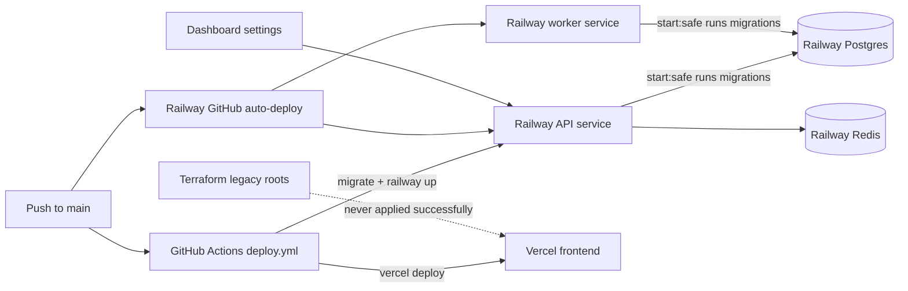
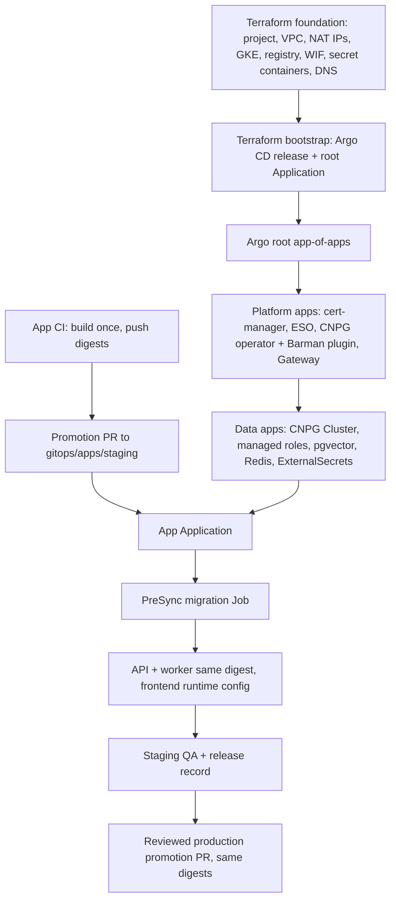
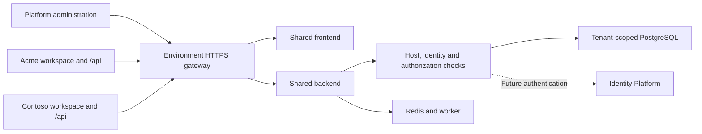

# CloudAnzen IaC and GitOps implementation plan

Updated: 2026-11-18. Status: architecture and phased implementation plan; no infrastructure or authentication migration has been performed by this documentation change.

This is the canonical plan. It supersedes earlier planning briefs. Architectural decisions are recorded in the [ADR index](adr/README.md). The configuration contract is in [configuration-inventory.csv](configuration-inventory.csv).

## 1. Outcomes and scope

Build reproducible staging and production environments on GCP using Terraform, GKE Autopilot, Argo CD and Helm. Run shared backend, worker and frontend services, with PostgreSQL and Redis in-cluster and explicit secret management.

The first milestone, **M1**, is a staging environment recreated from Git and documented inputs, with current CloudAnzen authentication, successful sign-in and a recorded GitHub integration QA cycle. It must require neither production secrets nor undocumented console settings.

Design now for two subsequent milestones:

- **M2 — tenant onboarding and subdomains:** `platform.cloudanzen.com` provisions organizations and customer-specific addresses. A tenant user's CloudAnzen login/session and every data request are restricted to the registered organization hostname. All customer hosts use the same backend deployment.
- **M3 — Firebase migration:** move authentication to Firebase Authentication with Google Cloud Identity Platform, preserving CloudAnzen user IDs, application authorization, tenant isolation and audit history.

M1 must establish compatible routing/configuration and identity-interface contracts; it does not implement production onboarding or replace authentication. M2 can use current authentication first. M3 is a separately designed and tested cutover. Do not block platform work on the full Firebase migration or advertise deferred features as delivered.

The existing Railway/Vercel deployment remains out of scope. Preserve its roots, state and release behavior. No current customer/domain/authentication cutover is authorized by this document. Dedicated customer deployments, customer-owned domains, per-PR environments and a public self-service signup/billing system are later work.

> **Out-of-scope risk with a near deadline:** Railway stops reading Config as Code files (`railway.json`/`railway.toml`) on **2026-12-01** ([Railway docs](https://docs.railway.com/config-as-code)). The legacy backend's start command (including boot-time migrations), health check and builder are declared there (backend `railway.json:6-10`). This affects the deployment current customers use and needs an owner outside this plan before that date.

### Essential for M1 versus later

| Essential for M1 | Can wait (not M1) |
| --- | --- |
| Staging GCP foundation, Argo bootstrap, platform add-ons, app chart | Production environment (M1 production gate, section 8) |
| Validated configuration contract with no production fallback | M2 tenant registry, onboarding UI and customer subdomains |
| Single migration owner; runtime/migration credential separation | M3 Firebase/Identity Platform migration |
| Digest promotion and release record | Per-PR preview namespaces |
| Backup/restore drill and drift reporting | Image signing/provenance, SBOM enforcement |
| Fixed OAuth callback host with signed state (section 6) | Cloudflare proxy/WAF in front of the gateway |
| Two synthetic tenant hosts in staging (contract proof only) | Redis HA (Sentinel/replication), dedicated installs through ApplicationSet |

### Non-goals

- Changing, migrating or retiring the Railway/Vercel deployment or its data.
- Replacing current authentication in M1; Firebase is M3.
- Managed Cloud SQL/Memorystore (in-cluster CloudNativePG and Redis were chosen).
- An additional secrets platform (Vault, Doppler, Infisical); see ADR-0003.
- Per-customer Terraform roots, Argo Applications or clusters for standard tenants.
- Automatic Terraform drift repair; drift is reported, then fixed through reviewed Git changes.

## 2. Decision register and evidence

| ADR | Binding direction | Unresolved implementation detail |
| --- | --- | --- |
| [0001](adr/0001-gcp-platform-and-delivery-ownership.md) | GKE shared services; one Terraform/Argo owner per resource; exact-digest promotion | Version compatibility, database topology and restore evidence |
| [0002](adr/0002-terraform-state-and-execution.md) | Separate state/credentials per environment and lifecycle; conditional HCP Free selection | Existing subscription/state, private execution, HCP versus GCS |
| [0003](adr/0003-secret-authority-and-delivery.md) | Secret Manager + ESO; containers/IAM only in Terraform | CNPG password convergence, rotation and initial Argo Git access |
| [0004](adr/0004-tenant-hostnames-and-onboarding.md) | Platform-led onboarding, registered tenant hosts, shared backend, host-bound access | Exact DNS suffix and later registry/session/provisioning implementation |
| [0005](adr/0005-firebase-identity-platform-migration.md) | Firebase/Identity Platform target; application authorization retained | Callbacks, import/MFA/session strategy, account-link policy, limits and costs |
| [0006](adr/0006-interim-single-cluster-topology.md) | One shared GKE cluster: staging/prod namespaces, per-environment projects for secrets and data | Platform upgrades tested on a temporary cluster; namespace isolation tests |

Accepted direction does not imply completed validation. Record decisions and evidence for each open item before its dependent apply or rollout.

Repository observations were checked on 2026-11-18 against the fetched default branches: infra `main` `c0d4b46`, backend `main` `f12b2b6`, frontend `main` `1462314` and QA `develop` `dc2f08a`. (Earlier drafts cited local feature-branch checkouts `7c195e9` and `dcf2421`; the lines below also hold on the default branches.) These are not assertions about deployed versions. Recheck relevant files before implementation.

| Observation | Evidence / consequence |
| --- | --- |
| Existing Terraform roots select HCP `staging` and `production` | `environments/staging/backend.tf:1`, `environments/production/backend.tf:1`; preserve until inventoried |
| Provider lock file is ignored | `.gitignore:5`; track lock files for the new roots |
| Terraform workflow posts plan output and applies staging then production on main | `.github/workflows/terraform.yml`; verify actual GitHub environment protections. Its explicit final failure check means `continue-on-error` does not silently make plan failure successful |
| The infra Terraform workflow failed in all four recorded runs (2026-04-04 to 2026-04-05; GitHub Actions history, read-only) | Failure is not proof of empty state or absent resources; inspect ownership and state metadata before migration/retirement |
| Existing GitHub `production` and `staging` environments in the backend and frontend repositories have no protection rules (GitHub API, read-only) | New GCP environments must have required reviewers and branch restrictions from creation |
| Railway provider source and module defects in legacy roots: wrong registry address `terraform-community/railway` (`environments/staging/backend.tf:12-15`); declared but unapplied service settings (`modules/railway-project/variables.tf:11-18`) | Legacy only; do not reuse. The new GCP roots use separate modules |
| Migrations run on startup and in release workflows | Backend `package.json:14`, `Dockerfile:86`, `.github/workflows/deploy.yml:67-70`; runtime containers receive the superuser-derived `MIGRATE_DATABASE_URL` (`src/scripts/build-database-url.ts`); blind `migrate resolve ... \|\| true` at `deploy.yml:46-65`. Create a separate GKE startup path and migration owner, preserving legacy behavior |
| Backend config contains production URL defaults | Backend `src/config/env.ts:47`, `:49`, `:108`; platform URL already exists, but one global customer URL is insufficient for M2 |
| Frontend falls back to the production API | Frontend `src/services/api/client.ts:22`; require explicit environment config and support relative same-origin `/api` |
| Existing users have globally unique email/Google ID, one organization link and session versions | Backend `prisma/schema.prisma:350`, `src/lib/tenant-session.ts`; preserve internal IDs and revocation semantics during M3 |
| Organization creation and onboarding setup already exist | Backend `src/modules/admin/organization-admin-service.ts`, `src/modules/platform-onboarding/setup-service.ts`; evolve into a durable provisioning flow rather than claiming it is already atomic/retry-safe |

The [configuration inventory](configuration-inventory.csv) was regenerated from these branches: 93 schema keys in `src/config/env.ts`, 23 direct `process.env` reads outside it, frontend/QA/CI/Terraform inputs and proposed new contracts (names only). The database requires `CREATE EXTENSION vector` and creates `isms_app`, `isms_app_rls` and `isms_admin_bypass` roles with `BYPASSRLS` across 135 migrations. No live state, billing, GCP configuration or credentials were inspected.

## 3. Target environment and ownership

Current state (legacy, out of scope; shown for dual-run context only):



Target delivery and bootstrap flow:



**Topology ([ADR-0006](adr/0006-interim-single-cluster-topology.md)):** one GKE Autopilot cluster hosts both environments in separate namespaces (`cloudanzen-staging`, `cloudanzen-prod`). The cluster, registry, VPC and Cloud NAT live in a platform project (`cloudanzen-gke`, candidate ID). Secrets, backup buckets and environment service accounts live in per-environment projects (`cloudanzen-staging`, `cloudanzen-prod`), so staging identities have no access to production secrets or data. There is one cluster only; a second (dedicated production) cluster is not planned and would need a new, explicit decision by the product owner. Region, organization/folder, billing account and domain suffix are explicit inputs.

The one Argo instance in `argocd` uses a separate `AppProject` per environment, restricting each to its own Git path and namespace; staging changes cannot target production. Namespaces have default-deny network policies, quotas, and a higher priority class for production. Cluster upgrades and cluster-wide operators affect both environments at once, so platform upgrades are tested on a temporary cluster first. State and recovery credentials remain outside the cluster. Standard tenants share services within their environment, with tenant-aware application/database isolation.



Platform and customer routes share infrastructure but require distinct audiences, access policies and sessions. A customer token does not authorize platform operations.

| Owner | Resources |
| --- | --- |
| Terraform foundation | Projects/APIs, VPC/subnets, Cloud NAT with **reserved static egress IPs** per environment (published so customers can allowlist CloudAnzen for integrations such as GitHub org IP allow lists or firewalled GitLab/Jamf/Vault), GKE, Artifact Registry, backup bucket, secret containers/IAM, shared DNS/Certificate Manager resources, federation and new GCP GitHub environments |
| Terraform bootstrap | Argo installation/upgrades, required bootstrap namespace/identity resources and root Application |
| Argo | cert-manager where required, ESO, CNPG/Barman, data services, workload chart, Gateway/HTTPRoutes and ready-state dependencies |
| Application repositories | Dockerfiles, runtime configuration contract, migrations, identity adapter and authorization behavior |
| Platform onboarding service (M2/M3) | Customer domain/organization records, invitations, entitlements and authentication tenants; customer records are not Terraform state |

Use explicit references from Argo routes to Terraform-owned shared certificate resources; do not let both tools manage a certificate or the Argo release.

Proposed new layout, alongside preserved legacy roots:

```text
docs/
  iac-gitops-implementation-plan.md
  adr/
terraform/
  modules/
  envs/staging/{foundation,bootstrap}/
  envs/prod/{foundation,bootstrap}/
gitops/
  bootstrap/
  platform/
  data/
  apps/{staging,prod}/
charts/cloudanzen/
```

### Dual-run with the legacy platform

Existing customers remain on the legacy Railway/Vercel deployment while the GCP platform onboards new customers, so two production platforms run concurrently until a separately approved consolidation. Defaults:

| Concern | Default |
| --- | --- |
| Hostnames | Confirmed: tenants on `<tenant>.app.cloudanzen.com` (staging `<tenant>.staging.app.cloudanzen.com`). `app.cloudanzen.com` becomes the GKE **canary** ring and `platform.cloudanzen.com` the GKE **admin** console, but only through a planned cutover; both serve the live legacy app today. Until cutover GKE uses temporary names (for example `app-next.cloudanzen.com`, `platform-next.cloudanzen.com`). See [ADR-0004](adr/0004-tenant-hostnames-and-onboarding.md) |
| Release unit | GCP releases are digest-promoted through this plan. The legacy stack keeps its own release path; version skew between platforms is expected and recorded in each release record |
| Incident ownership | Each platform has a named on-call owner and runbook; incidents are not assumed to apply to both |
| Customer data | No legacy customer data moves to GCP without a separate, rehearsed migration decision. Real customer data never becomes staging or test data |
| Consolidation | Retiring the legacy stack or moving its tenants is a later decision with its own data-migration and DNS plan |

## 4. State, execution and bootstrap

Follow ADR-0002. Verify current HCP subscription, organization-wide usage, state ownership and access/execution capabilities before selecting HCP. The current Free limit is 500 managed resources per organization, not per workspace; verify current terms at selection time. See [HCP plans](https://developer.hashicorp.com/terraform/cloud-docs/overview).

If suitable, use new `gcp-<environment>-foundation` and `gcp-<environment>-bootstrap` HCP workspaces. Otherwise choose versioned GCS state with locking and separate environment access, executed through GitHub Actions. The selected backend has one writer and production approval; there is no automatic paid upgrade or backend fallback. State migration requires a restricted backup, paused writers, lineage/serial checks and a verified no-change plan.

Foundation uses cloud APIs. Bootstrap accesses the already-created cluster. Validate private API reachability from its executor; if required, use a protected GCE-hosted agent/runner outside that cluster with environment-specific access. Include its cost and enrollment/renewal in the design. Do not assume a hosted runner can reach private endpoints. Bootstrap the state backend and federation trust through a documented authorized administrator session before using them.

Initial installation order:

1. Confirm account access, state ownership/backend, regional quotas and cost scope.
2. Provision foundation, workload identities and secret containers.
3. Seed required staging secret versions using a protected workflow.
4. Install Argo through Terraform; wait for its CRDs before planning/applying the root custom resource. Use separate bootstrap invocations/resources as required by provider planning behavior.
5. Securely seed Argo's private-Git credential from Secret Manager without Terraform/Helm payloads, then enable the root Application.
6. Install add-ons/ESO; transfer the Git credential Secret to ESO and verify reconciliation.
7. Reconcile data/credential applications and verify CRDs/controllers, ServiceAccounts, ExternalSecrets, database roles/connectivity and Redis readiness.
8. Sync the app: migration Job first, then workloads, then health and QA gates.

Use explicit prerequisite readiness and verify child-Application health for the pinned Argo version. Sync-wave ordering alone is insufficient. First-install and credential-update paths must both work. Migration prerequisites must already exist before app `PreSync` runs.

Pin an Argo CD minor version that is in upstream support and record it in the bootstrap root. Argo 3.3 reached end of life on 2026-11-03; supported lines at review time were 3.4, 3.5 and 3.6 ([releases](https://github.com/argoproj/argo-cd/releases)). Terraform owns Argo upgrades: review release notes quarterly, upgrade staging first, and never fall more than one supported minor behind.

## 5. Workloads, secrets and configuration

Deploy API and worker from the same image digest with startup/readiness/liveness probes, appropriate resource requests, disruption policy and measured scaling settings. Use an nginx/static frontend image with validated public runtime configuration; do not rebuild it for each environment or tenant.

The app chart references separately managed PostgreSQL, Redis and credentials. Proposed PostgreSQL is CloudNativePG with a three-instance HA target, a supported pgvector path, WAL archiving and Barman/GCS backups. Validate the PostgreSQL 18/extension-image proposal, Autopilot support and operator compatibility in a disposable spike before pinning versions. Price staging topology separately. Redis/Valkey uses a maintained official image, persistent storage, AOF and `noeviction`; document queue-loss recovery. Do not use Bitnami charts or images: since August 2025 free versioned Bitnami images moved to an unpatched `bitnamilegacy` repository.

Redis starts as a **single replica**. Losing its volume loses queued and delayed BullMQ jobs (scans, notifications, outbox delivery) and rate-limit counters; it does not lose PostgreSQL data. The recovery runbook must define how scheduled scans are re-enqueued and whether pending outbox work can be replayed from PostgreSQL (verify against the code before relying on it), extending the backend's existing procedure (backend `docs/portal/incident-recovery.md`, section "Redis and queued work"). Redis HA (Sentinel or Valkey replication) is a later decision triggered by measured job-loss impact, not implied by M1.

Audit and replay historical migrations under intended identities. Pre-creating a role with BYPASSRLS does not prove a non-superuser can replay all `CREATE/ALTER ROLE`, extension and grant statements. Separate privileged bootstrap, migration and runtime capabilities; verify actual runtime role memberships and tenant/RLS behavior. Never copy blind `migrate resolve ... || true` commands into the new path.

Argo owns app migration execution with one serialized `prisma migrate deploy` Job per environment sync. Repeated syncs must be safe. Runtime pods never receive migration credentials.

The chart uses **Argo CD hook annotations only** (`argocd.argoproj.io/hook: PreSync`, explicit `hook-delete-policy`). Argo maps Helm `pre-upgrade` hooks to `PreSync`, but if an application contains any Argo hook, all Helm hooks are ignored ([Argo Helm docs](https://argo-cd.readthedocs.io/en/stable/user-guide/helm/)). Mixing the two would make migration ordering ambiguous. A `helm template` CI check rejects `helm.sh/hook` annotations in the app chart. Use a GKE-specific startup without migrations, preserving the existing deployment entrypoint until a separately reviewed retirement.

Apply ADR-0003: Secret Manager → ESO through Workload Identity → namespaced runtime Secrets. Terraform manages containers/IAM only. Database application and migration passwords have distinct external authority; operator-internal credentials are explicitly separate. Test actual password changes, ESO version convergence and application reload/restart. Do not assume that a Secret update alone rotates PostgreSQL credentials.

Use default-deny network policies with required database/queue/DNS/provider egress. Define a workable egress control for public provider APIs; do not claim ordinary IP-based policies enforce arbitrary domain allowlists. Keep staging identities and configuration from accessing production resources. Validate frontend artifacts contain no private credentials.

### Configuration contract

[configuration-inventory.csv](configuration-inventory.csv) lists 162 configuration items by name only: backend schema keys and direct environment reads, legacy Railway-only inputs, proposed new contracts, frontend values, QA inputs, CI identities, Terraform inputs, and category rows for tenant settings and customer integration credentials. Each row records purpose, consumers, M1 requirement, build/runtime use, classification, current source, current default risk, proposed authority and delivery, validation, rotation/reload, isolation and evidence. PR2 refreshes it against the reviewed commit and keeps it current; a row is added or changed in the same PR as the configuration it describes.

In addition to current variables, define these conceptual inputs before implementation. Names below are proposed contracts, not existing application settings:

| Input | Contract |
| --- | --- |
| Deployment environment and platform origin | Explicit staging/prod distinction; no fallback to production URLs |
| Customer host suffix and gateway trust policy | Exact suffix, normalized registered-host resolution and trusted proxy sources; a suffix match alone grants nothing |
| Browser API base | Same-origin `/api` through the customer host; separate authenticated contracts for agents/webhooks |
| Tenant domain registry | Application data, not environment variables per organization; canonical origin is used for invitations, reset emails and links |
| Authentication mode / adapter | Existing provider for M1; explicit per-organization migration mode later, with no silent downgrade |
| Identity project / public web configuration | Separate environment projects; provider tenant is resolved from the registered organization; public IDs are not secrets |
| Authentication handler and callback allowlist | Validated exact destinations and browser-compatible provider flow; do not assume wildcard DNS authorizes redirects |
| OAuth callback host and state signing | One fixed callback host per environment for Google sign-in and integration OAuth (GitHub OAuth Apps accept a single callback URL and its subpaths). Signed, server-stored, single-use state binds the flow to the initiating registered tenant host and session; the callback then redirects to that host. Today the GitHub integration state is unsigned base64 (backend `src/modules/integrations/providers/integration-oauth-routes.ts:80-82`), so signed state is an M1 prerequisite |
| Cloudflare edge mode | DNS-only in M1: the GKE Gateway terminates TLS and is the only trusted proxy. Enabling Cloudflare proxying later changes trusted-proxy CIDRs, client-IP and forwarded-header handling and certificate validation, and needs its own decision |
| Secret references | Names/version identifiers where required, never secret payloads in runtime public configuration |

Validate environment-level values with the backend schema and Helm `values.schema.json`. Tenant-level values are validated by the application registry, not by one global Helm URL list. Remove GKE production fallbacks and fold direct environment reads into the validated contract. Preserve necessary legacy defaults only on an explicitly separate legacy path.

## 6. Tenant and authentication compatibility

These are required design contracts now, with implementation phases in section 8.

### Tenant routing and platform onboarding

Use a shared gateway with the proposed customer pattern `*.app.cloudanzen.com` and a separate staging pattern, subject to domain-owner confirmation. A wildcard certificate must support the exact selected suffix; it does not cover arbitrary deeper hostnames. Certificate Manager/Gateway selection needs a staging validation. No DNS changes are made by this plan.

Resolve registered hosts to immutable organization IDs. Every tenant request must match the verified identity/session's permitted organization. Reject unknown, reserved, suspended and retired hosts and cross-tenant replay. Trust only validated gateway host metadata; strip spoofable forwarded headers and prevent direct-origin/shared-API login bypass. Keep non-browser endpoints explicitly authenticated and tenant-bound.

OAuth providers cannot call back to every tenant host: GitHub OAuth Apps accept one callback URL, and current Google sign-in and integration callbacks are single configured URLs. Use the fixed per-environment callback host and signed, server-stored, single-use state from the configuration contract; the callback establishes nothing on its own host and redirects only to the registered tenant host recorded in that state.

Use host-only application cookies and explicit CSRF/redirect controls; do not share cookies across the parent customer domain. Keep `platform.cloudanzen.com` permissions/audience separate. Existing public Trust Center domain mappings do not establish authenticated workspace access. The exact suffix and the migration behavior of the old shared customer URL remain explicit rollout decisions.

M2 extends the existing platform onboarding services with a durable, observable provisioning operation, unique domain reservation, idempotent seeding, recorded remote IDs and safe retries. Uncertain external outcomes require reconciliation. A narrowly privileged worker performs provisioning; tenant application requests do not get unrestricted identity-administration permissions. An inactive/incomplete organization cannot log in. Invite acceptance, integration consent and scope selection are separate steps; seeding never awards compliance credit.

No per-customer Terraform or Argo app is required for standard onboarding. Customer-owned domains and dedicated deployments need their own future design. See [ADR-0004](adr/0004-tenant-hostnames-and-onboarding.md).

### Future Firebase migration

Use Firebase Authentication with Identity Platform as the future target, with an authentication tenant per organization as the design default and distinct environment projects. CloudAnzen remains authoritative for roles, entitlements, membership, audit scope and data authorization. Provisioning APIs belong to the onboarding service; shared APIs/IAM belong to Terraform.

Preserve internal user IDs. Add a provider/project/tenant/subject identity link, with no automatic linking by email. Review current globally unique email and single-organization constraints before same-email multi-tenant or auditor scenarios. Maintain session-version, role/removal and suspension behavior.

The M3 spike must validate tenant-specific verification, disabled/revoked identities, MFA, email actions, account import, provider configuration automation, authorized domains, callback hosting and browser storage restrictions. Choose the final application/provider session mechanism based on that evidence. No Firebase migration, service enablement, secret creation or auth fallback change is part of M1.

Roll out through explicit organization migration status. A failure in the new provider cannot silently re-enable legacy login for a migrated organization. Restore/migration procedures must account for password changes, MFA re-enrollment, old sessions and linked identities. See [ADR-0005](adr/0005-firebase-identity-platform-migration.md).

## 7. GitHub Actions and release workflow

Keep infrastructure and app delivery separate. Path filters must prevent documentation or application-manifest changes from applying unrelated Terraform roots or legacy environments.

1. Build/test app images after registry/federation prerequisites exist. Publish immutable backend/worker and frontend digests.
2. A scoped GitHub App opens a staging manifest PR with the release tuple: app digests, chart version and public configuration revision. Check the exact PR head. Begin with reviewed merges; any later auto-merge policy must preserve these gates.
3. After merge, Argo waits for prerequisites, runs migration, rolls workloads and reports health. GitHub Actions does not also invoke Helm/apply/migrations for this release.
4. Run staging QA against that candidate. Record observed deployment digests/revisions and reject results if another deployment replaces it during the cycle. Serialize or explicitly reserve the acceptance window.
5. Open a production promotion PR using the same image digests/chart and referencing the passing staging record. Review production configuration, migration and secret-version differences; revalidate the candidate before approval.
6. Argo deploys the approved production Git revision. Verify health and create/finalize the release record and GitHub Release afterward. A release event must not trigger an independent deployment bypass.

The release record contains app commits, digests, chart version, configuration/infra revision, migration head, appropriate non-secret version references, Argo revision and QA/deployment links. Reverting a release manifest only restores compatible application/configuration references; it does not reverse database migrations or credential rotation. Use expand-and-contract schema changes, forward fixes and separate tested recovery procedures.

Terraform plans on relevant PRs and applies through one selected execution path with production approval. Never post raw plans or secret artifacts to PRs. Scheduled `plan -detailed-exitcode` distinguishes no drift (0), drift (2) and errors (1), without automatic repair. Argo self-heals only its owned resources. Document break-glass suspension of sync and reconciliation back into Git.

## 8. Implementation sequence and completion gates

The following are work packages. A row spanning repositories requires coordinated repository-specific PRs. There are no new commits, PRs or deployments from the documentation work itself.

| Package | Repository | Work and dependency | Completion evidence |
| --- | --- | --- | --- |
| PR1 | infra | Isolated GCP roots/workflows, lock files, state/account inventory, backend/executor decision, scoped environment protections; preserve legacy configuration | Existing ownership documented; backend chosen; no unrelated apply path; safe plan/failure handling |
| PR2 | backend | Validated GKE config/startup; migration decoupling; define trusted-host and identity-adapter contracts without changing login provider | Existing auth works; missing/cross-environment config rejected; no migrations at GKE pod startup; legacy behavior preserved |
| PR3 | frontend + QA | Runtime public config/static image; relative `/api`; explicit QA URLs; same artifact supports two synthetic registered hosts | Build has no private credentials/production fallback; browser routes and environment assertions pass |
| PR4 | infra | Staging foundation and costed compatibility spike; registry/federation, network, cluster, state, secret IAM, backup storage and private execution | Reproducible foundation; private API reachability; selected operator/Postgres/pgvector versions proven |
| PR5 | backend + frontend | Image publication, version reporting and scoped promotion credentials; depends on PR2–PR4 | Images publish via federation and are identifiable by digest; no direct GCP deployment bypass |
| PR6 | infra | Argo bootstrap, private Git/ESO handoff, platform add-ons, shared certificate and gateway prerequisites | Fresh-install bootstrap succeeds without secret payloads in Terraform; child/secret readiness enforced |
| PR7 | infra + backend as required | Separate data/credential apps and app chart; real-role migration replay; tenant-safe configuration; synthetic hostname boundary tests | Runtime isolation, repeatable migration, staged rotation and first-install tests pass; unknown hosts rejected |
| PR8 | infra | Staging manifests, promotion/release record, platform/customer route separation | Correct version deployed; wrong host/audience denied; exact QA-tested tuple required for production |
| PR9 | QA | Staging GitHub cycle and minimum two-organization route/session probes using current auth | Version-linked report; host mismatch/spoof/direct-origin tests pass for the enabled routing surface |
| PR10 | infra | Backup/restore drill, drift schedule, recovery/rotation/break-glass runbooks | Measured RPO/RTO and compatible rollback evidence; missing secrets and dependency failures handled |
| M1 production gate | all affected | Staging acceptance and cost/access review, then the production namespace on the shared cluster: production project (secrets, backups, service accounts), `AppProject`, data apps and values | Separate identities/secrets, namespace isolation tests, approved production configuration and deployment verification before new-platform customers |
| Hostname cutover (later) | infra + legacy owner | Move `app.cloudanzen.com` (canary) and `platform.cloudanzen.com` (admin) to GKE after production acceptance; decide Cloudflare proxy mode for them (`app` is proxied today) | Approved change window, rollback, and a new home for legacy users of these hostnames |

M1 synthetic host tests are a bounded staging proof of the routing/session contract, not a production customer registry or onboarding release. Do not enable a public customer wildcard login surface until the full M2 access gate is satisfied.

### 8a. First sprint (about two weeks)

Goal: remove the main unknowns and land the guards every later package depends on.

| Item | Output | Done when |
| --- | --- | --- |
| PR1 infra reset | New `terraform/`, `gitops/`, `charts/` skeleton; tracked lock files; plan-only PR workflow with no raw plan comments; protected GitHub environments; legacy roots untouched | Workflow green on a no-op plan; no apply path from documentation changes |
| PR2 (first half) | `APP_ENV`, removal of production defaults on the GKE path, schema coverage for direct reads, migration-free GKE entrypoint behind the existing legacy entrypoint | Missing or cross-environment values fail at boot in tests; legacy behavior unchanged |
| GCP access request | Organization/folder, billing account, region and three project IDs (shared cluster project, staging, production) confirmed by the account owner | Non-secret IDs recorded; no resources created yet |
| Throwaway Autopilot spike | CNPG with the chosen PostgreSQL/pgvector image, Barman backup to GCS through Workload Identity, Argo bootstrap, ESO from Secret Manager, Gateway with a wildcard certificate | Written findings with pinned versions, or a documented fallback; spike project deleted |
| Inventory refresh | [configuration-inventory.csv](configuration-inventory.csv) re-checked against PR2's commit | Every M1-required row has an owner and authority |

Follow-on work is separately scoped:

| Milestone | Scope | Gate before enabling |
| --- | --- | --- |
| M2a | Durable tenant/domain registry, canonical-host resolution and host-bound sessions with current authentication | Full wrong-host/session-replay, suspended/unknown host, CSRF, direct-origin and platform separation tests |
| M2b | Platform UI/worker onboarding, invitation lifecycle, status/retry/cancellation and operational recovery | Duplicate requests and interrupted provisioning recover without duplicate identities or partial active tenants; QA lead acceptance |
| M3a | Identity Platform compatibility/cost and migration rehearsal | Auth tenant/provider/domain limits, redirect strategy, user/MFA/session import/re-enrollment decisions documented |
| M3b | Tenant-aware identity adapter, identity links and explicit per-organization Firebase cutover | Negative isolation tests, audit continuity, recovery/revocation and rollback tested; separate rollout decision |

## 9. Acceptance and recovery requirements

For M1:

- Recreate staging from Git and the documented bootstrap inputs; no production secret read is needed.
- State has one writer, locking, restricted access and a recovery procedure. No automatic upgrade/backend migration occurs.
- Recover Argo/private Git access independently of the managed cluster and demonstrate the ESO credential handoff.
- Controllers, data roles, secrets and migration prerequisites are ready before app sync. Missing/invalid configuration does not fall back to production.
- Replay migrations under selected identities and run two-tenant checks under the real runtime role.
- Backend/worker share a digest; the frontend uses public runtime config and same-origin API routing.
- Test two synthetic hosts, spoofed host metadata, origin bypass and platform/tenant separation for the routing implemented in M1. Unsupported host modes remain disabled.
- A failed upgrade migration prevents new workload rollout; existing serving pods remain available where schema compatibility permits. Repeat syncs cannot run concurrent migrations.
- Test credential rotation against the actual database/provider and consumer restart/reload behavior.
- QA reports match observed digests/revisions; production promotion cannot silently rebuild or substitute images.
- OAuth sign-in and the GitHub integration complete through the fixed callback host; tampered, replayed or wrong-host state is rejected.
- The app chart contains no `helm.sh/hook` annotations; migration ordering relies on Argo hooks only.
- Staging egress uses the reserved static NAT IPs, which are documented for customer allowlisting.
- Namespace isolation on the shared cluster: staging service accounts cannot read production secrets or backups; network traffic between the staging and production namespaces is denied; the staging `AppProject` cannot deploy into the production namespace; staging pods are preempted before production under resource pressure.
- Report Terraform/Argo drift within one day. Measure rollback time and database backup/restore RPO/RTO, with explicit targets agreed before customer onboarding.

For M2/M3, the ADR-0004/0005 acceptance cases additionally cover real customer lifecycle, host-bound login, identity-tenant mismatch, stale/disabled identities, invitations/reset/MFA and no legacy-auth fallback after migration. A passing deployment health check is not evidence of tenant isolation or migration correctness.

Recovery runbooks must name owners and cover state loss, Argo Git credentials, Secret Manager/ESO outage, database restore, Redis loss, migration failure, disabled/suspended tenants and identity-provider outage. Preserve domain reservations and data retention during failed onboarding/offboarding; do not cascade-delete business history as compensation for a provisioning error.

## 10. Manual inputs, estimates and remaining decisions

No account action is required to review these documents. The implementation agent first checks existing access and prepares exact commands/permissions; the user only performs missing account-owner actions. Do not request secret payloads in chat.

| Timing | Required input | Agent responsibility | User/account owner if needed |
| --- | --- | --- | --- |
| Before PR4 | GCP organization/folder, billing, project IDs, region and cost envelope | Prepare IAM/bootstrap/API/quota requirements and estimate | Enable billing/grant agreed access; supply non-secret IDs and business constraints |
| Before backend selection | Existing HCP subscription, usage and workspace/state ownership | Inspect accessible metadata and compare executor/backend options | Confirm unavailable account details; no paid purchase solely for workspaces |
| Before gateway provisioning | Platform and customer/staging domains | Prepare shared DNS/certificate/route design and reserved names | Confirm exact suffix and DNS ownership/access |
| Before private Git/promotion | GitHub App installations and environment reviewers | Supply minimal separate read/promotion permissions and protected workflow design | Org owner installs/approves where required; secrets go directly to the store |
| Before staging sign-in | Current environment-specific OAuth registrations | Supply exact callbacks and secure secret seed instructions | Approve/register providers and store credentials through the protected process |
| Before M3 | Identity Platform configuration, SSO needs, user migration and pricing decisions | Run synthetic compatibility/migration spike; document partial automation/manual provider steps | Approve required identity settings, customer-admin SSO cooperation and later cutover |
| Before QA | Dedicated test organization and integration accounts | Reuse QA repo with explicit staging configuration | QA lead supplies test access and reviews acceptance |

### Cost drivers (order of magnitude; verify with the GCP pricing calculator)

| Driver | Assumption per environment | Price basis |
| --- | --- | --- |
| GKE cluster management fee | 1 shared Autopilot cluster (ADR-0006) | $0.10 per cluster-hour (about $73/month), offset by the $74.40/month credit per billing account, so roughly no net fee. No second cluster is planned ([GKE pricing](https://cloud.google.com/kubernetes-engine/pricing)) |
| Autopilot workload requests | API 2 pods, worker 1–2, frontend 2, CNPG 3 instances, Redis 1, Argo/ESO/cert-manager/CNPG controllers | Billed per requested vCPU, memory and ephemeral storage. Size from measured staging requests; staging can run smaller requests and fewer replicas |
| Persistent disks | 3 CNPG volumes plus WAL, 1 Redis volume | Compute Engine Persistent Disk/Hyperdisk rates |
| Backups | Barman base backups and WAL in GCS with retention | Cloud Storage class, operations and retention |
| Network | Cloud NAT gateway with reserved static IPs, egress to provider APIs, load balancer | Cloud NAT, IP and egress rates |
| Platform services | Artifact Registry storage, Secret Manager versions and accesses, Certificate Manager | Per-service list prices; disabled secret versions are still billed |
| State and execution | HCP Terraform Free (500 managed resources per organization) or GCS backend; GitHub-hosted runners, plus a private runner if the cluster API is private | HCP plan terms; runner VM if needed |
| M3 only | Identity Platform active users, SMS MFA | [Identity Platform pricing](https://cloud.google.com/identity-platform/pricing) |

Exact regional prices and the account's billing terms are unverified. Present a priced estimate to the account owner before PR4.

### Effort

Assumes two engineers at about 70% availability (about 7 engineer-days per week combined), excludes M2/M3, and includes testing and documentation per package.

| Package | Best | Expected | Conservative |
| --- | --- | --- | --- |
| PR1 infra reset | 2 | 3 | 5 |
| PR2 config contract, migration decoupling, signed OAuth state and fixed callback host | 5 | 8 | 12 |
| PR3 frontend runtime config, QA explicit URLs | 3 | 4 | 6 |
| PR4 staging foundation and spike | 5 | 8 | 12 |
| PR5 image publication | 2 | 3 | 5 |
| PR6 Argo bootstrap and add-ons | 4 | 6 | 9 |
| PR7 data apps, app chart, migration replay, host tests | 8 | 12 | 18 |
| PR8 staging manifests, promotion, release record | 3 | 4 | 6 |
| PR9 QA cycle and two-organization probes | 3 | 4 | 6 |
| PR10 restore drill, drift, runbooks | 4 | 6 | 9 |
| Namespace isolation for the shared cluster (AppProjects, quotas, priority classes, per-namespace SecretStores, isolation tests) | 3 | 4 | 6 |
| **M1 staging total** | **42** | **62** | **94** |
| Production gate (production namespace, project, data apps, values, review) | 5 | 8 | 12 |

At about 7 engineer-days per week, the expected M1 staging total is about 9 weeks of capacity. With dependency waits (GCP access, OAuth registrations, spike results) plan for 10–13 weeks. Confidence is low to medium until the spike pins the database and bootstrap versions. Re-estimate after the first sprint.

### Decisions needed (with recommended defaults)

| Decision | Recommended default | Needed before |
| --- | --- | --- |
| Customer host suffix and staging suffix | **Decided:** `*.app.cloudanzen.com` and `*.staging.app.cloudanzen.com`; staging system hosts `app.`, `api.` and `platform.staging.cloudanzen.com` (2026-11-21) | — |
| Canary and admin hostnames | **Decided:** `app.cloudanzen.com` (canary) and `platform.cloudanzen.com` (admin) after a planned cutover; temporary `app-next`/`platform-next` names until then | Cutover approval and a new home for legacy users |
| Cluster topology | **Decided:** one shared cluster for staging and production (ADR-0006); no second cluster planned | — |
| Terraform state backend | Keep HCP Terraform Free while under 500 managed resources; documented GCS backend as the alternative | PR4 |
| Region | One region close to initial customers and data-residency needs, for example `europe-west1` or `us-central1`; confirm with the account owner | PR4 |
| PostgreSQL and pgvector | Decided (2026-11-20): CNPG `standard` PostgreSQL 18 image, which includes pgvector. Autopilot rejects the `image` volumes that CNPG extension images need | PR7 |
| Recovery targets | Production RPO 15 minutes and RTO 4 hours, measured by the restore drill before customers | PR10 |
| Cloudflare edge mode | DNS-only in M1 | PR4 |
| Session mechanism under tenant hosts | Host-only CloudAnzen server session after verified login (current authentication in M1) | PR2 |
| Same-email and multi-organization identities | No automatic linking by email; one organization per user until a reviewed multi-membership design | M2/M3 |
| Cost ceiling | Monthly ceiling set by the account owner after the priced estimate; budget alerts in Terraform | PR4 |

No extra cluster, paid subscription or migration is approved merely by selecting an ADR direction.

## 11. References and document maintenance

The [ADR index](adr/README.md) contains decision status and links. Preserve current implementation facts separately from target behavior. Recheck provider support, quotas and pricing before implementation; no version number from the earlier brief is a compatibility guarantee.

- [GKE Gateway and certificate configuration](https://docs.cloud.google.com/kubernetes-engine/docs/how-to/deploying-gateways) informs the wildcard route/certificate spike.
- [Firebase tenant administration](https://docs.cloud.google.com/identity-platform/docs/multi-tenancy-managing-tenants) informs the tenant-aware verification and automation boundaries.
- [Firebase redirect behavior](https://firebase.google.com/docs/auth/web/redirect-best-practices) informs browser/callback validation.
- [Identity Platform pricing](https://cloud.google.com/identity-platform/pricing) informs the future identity cost estimate.

Before each implementation package, refresh repository evidence and record the reviewed commit. Keep ADRs, this plan, configuration inventory and release/runbook artifacts consistent. Documentation validation includes local-link resolution, table structure, conflict-marker/whitespace checks and a check that deferred features are not described as deployed.
